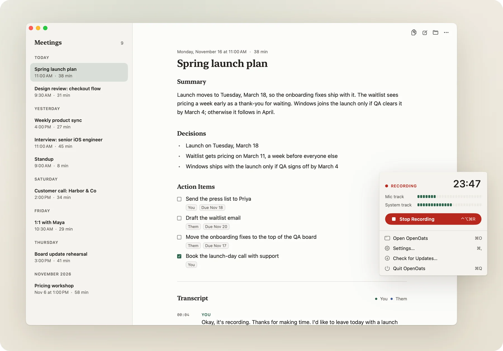
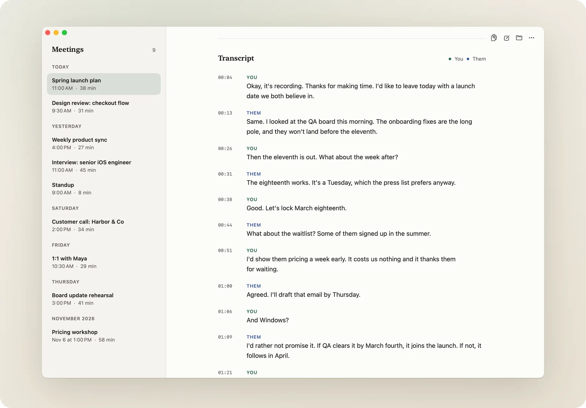
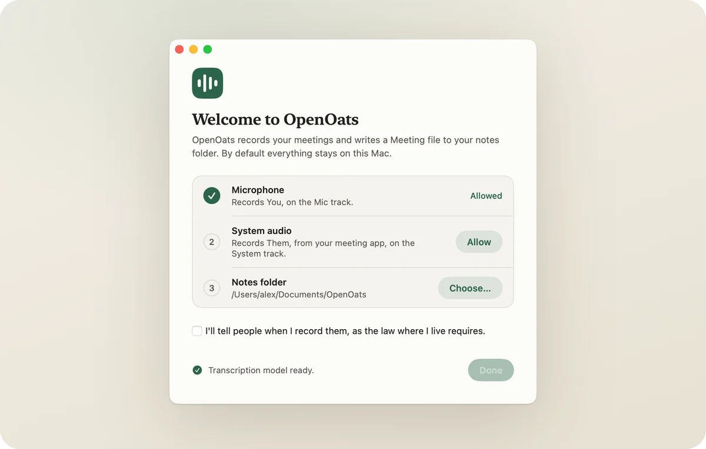

<p align="center">
  
</p>

<h1 align="center">OpenOats</h1>

<p align="center">
  <b>The meeting recorder for Mac that you can forget is running.</b><br />
  Press Start, have your meeting, press Stop. You get one markdown file: Notes on top, a You/Them transcript underneath.
</p>

<p align="center">
  <a href="https://github.com/yazinsai/OpenOats/releases/latest/download/OpenOats.dmg"></a>
</p>

<p align="center">
  Free and open source · Transcribes on your Mac · No account, no bot in your call
</p>

<p align="center">
  <picture>
    <source media="(prefers-color-scheme: dark)" srcset="assets/hero-dark.webp" />
    
  </picture>
</p>

## How it works

1. **Press Start.** Click the menu bar icon or press ⌃⌥⌘R from any app. OpenOats records your microphone and your Mac's audio as two separate tracks, so it works with Zoom, Google Meet, Teams, Slack, FaceTime or anything else that plays sound.
2. **Press Stop.** OpenOats transcribes each track in one pass, on your Mac. An hour of audio takes about a minute on Apple Silicon.
3. **Read the Meeting file.** A notification tells you it's ready. The file lands in your notes folder: Notes at the top (summary, decisions, action items), the timestamped Transcript below. Here's [an example](docs/example-transcript.md).

That's the whole app. There is nothing to set up before your first meeting and nothing to watch while it runs.

<p align="center">
  <picture>
    <source media="(prefers-color-scheme: dark)" srcset="assets/transcript-dark.webp" />
    
  </picture>
</p>

## Built so you don't lose a meeting

- **Crash-safe.** Audio goes to disk every couple of seconds. If your Mac crashes, the app is force quit or the battery dies, OpenOats recovers the Meeting the next time it opens. In our kill test the recording lost 1.1 seconds.
- **Quiet while you talk.** Nothing is transcribed during the call. Recording uses under 2% of one CPU core, and the app sits at about 19 MB of memory. Speech models load after Stop and unload when they're done.
- **Transcripts that read well.** Each side is transcribed as a whole, so sentences don't break halfway and less speech gets lost.
- **You and Them from the audio itself.** Your mic is You and your Mac's audio is Them. If your mic picks up the other side through your speakers, that echo is removed.

## Private by default

- Transcription runs on your Mac: Parakeet v3 for 25 European languages and Whisper large-v3-turbo for the rest, picked from your language setting.
- Nothing leaves your Mac unless you turn on a cloud service yourself. There is no account to create.
- API keys you add are stored in the macOS Keychain.
- Meeting files are plain markdown in a folder you choose. They open in Obsidian or any editor, and action items use Dataview fields (`[owner:: You]`, `[due:: 2026-11-20]`).
- You can have the audio deleted once the Meeting file is written.

## AI, only if you want it

Out of the box you get the Transcript with no key and no service. To get Notes as well, pick a Notes backend in Settings › AI:

- **On your Mac:** Ollama, LM Studio, MLX, llama.cpp
- **In the cloud:** OpenAI, OpenRouter, Requesty, Anthropic, Gemini, or any OpenAI-compatible endpoint

The Notes backend only ever sees text. It writes the summary, decisions and action items, and fixes the spelling of names and terms you add under Vocabulary.

You can also send transcription to a cloud or self-hosted service: OpenAI, Groq, ElevenLabs, AssemblyAI, Gemini or your own Whisper server. Every backend has a Test button.

## Install

Download [OpenOats.dmg](https://github.com/yazinsai/OpenOats/releases/latest/download/OpenOats.dmg), open it and drag OpenOats to Applications. Or use Homebrew:

```bash
brew tap yazinsai/openoats https://github.com/yazinsai/OpenOats
brew install --cask openoats
```

The first launch is one screen: allow the microphone, allow system audio recording, pick a notes folder. The on-device speech model downloads in the background while you do that. Updates install from inside the app.

**Requirements:** an Apple Silicon Mac with macOS 14.2 (Sonoma) or later.

<p align="center">
  <picture>
    <source media="(prefers-color-scheme: dark)" srcset="assets/onboarding-dark.webp" />
    
  </picture>
</p>

## More

- **Import.** Drop an audio file on the window and it's processed like a Meeting.
- **Retry.** If a cloud backend fails, the Meeting is marked Needs attention and Retry picks up from the last finished step.
- **Command line.** The app ships with `oats`, which turns audio files into a Meeting file from the terminal. Run it with no arguments to see the other commands.

  ```bash
  /Applications/OpenOats.app/Contents/MacOS/oats transcribe mic.wav system.wav > meeting.md
  ```

## Recording consent

OpenOats records audio from your microphone and from your Mac. Many places require consent from some or all participants before a conversation is recorded (for example, all-party consent states in the U.S., and the GDPR in the EU). You are responsible for knowing the law where you are and for telling people when you record them. The developers give no legal advice and accept no liability for recordings made with OpenOats. The app asks you to confirm this before your first recording.

## Staying on 1.x

OpenOats 2.0 is a different app from 1.x. The live transcript, live suggestions, knowledge base, Sidecast, Ask and calendar integration are gone. If you rely on them, click "Skip This Version" when the update appears. The last 1.x release stays on the [releases page](https://github.com/yazinsai/OpenOats/releases) and the code lives on the [`1.x` branch](https://github.com/yazinsai/OpenOats/tree/1.x). The [2.0 release notes](docs/release-notes-2.0.md) list everything that changed and what carries over.

## Contributing

Bug reports and pull requests are welcome. OpenOats 2.0 is small on purpose (about 4,000 lines of Swift), so read [PLAN.md](PLAN.md) and [GLOSSARY.md](GLOSSARY.md) before proposing a feature.

```bash
# Build dist/OpenOats.app (with the bundled oats CLI), sign it and install it to /Applications
./scripts/build_swift_app.sh

# Build into dist/ only, with or without signing
SKIP_INSTALL=1 ./scripts/build_swift_app.sh
SKIP_SIGN=1 SKIP_INSTALL=1 ./scripts/build_swift_app.sh

# Dev build and tests
cd OpenOats && swift build && swift test

# Package a DMG (needs dist/OpenOats.app)
./scripts/make_dmg.sh
```

Building needs Xcode 26 (Swift 6.2). Optional environment variables for signing and notarization: `CODESIGN_IDENTITY`, `APPLE_ID`, `APPLE_TEAM_ID`, `APPLE_APP_PASSWORD`. `APP_VERSION` overrides the bundle version (default: the latest git tag). The on-device golden tests (`OnDeviceGoldenTests`) are skipped unless a recording exists at `OATS_GOLDEN_CLIP`.

```
OpenOats/                     Swift package
  Sources/OatsCore/           Recorder, Processing pipeline, backends, Meeting store, settings, 1.x migration
  Sources/OatsOnDevice/       On-device transcription (Parakeet v3, Whisper large-v3-turbo)
  Sources/OatsCapture/        Mic track and System track capture
  Sources/oats/               CLI, also the app's Processing child (Contents/MacOS/oats)
  Sources/OpenOats/           SwiftUI menu bar app, Info.plist, entitlements, icon
  Tests/                      Core tests and opt-in golden tests
UITests/                      UI smoke suite
scripts/                      Build, sign, package, appcast and cask scripts
docs/                         Meeting file format, ADRs, release notes
```

> [!NOTE]
> **Sponsored by Recall.ai, an API for desktop recording.**
> If you need a hosted recording API, [Recall.ai](https://dub.sh/openoats) records Zoom, Google Meet, Microsoft Teams, in-person meetings and more.

## License

MIT
